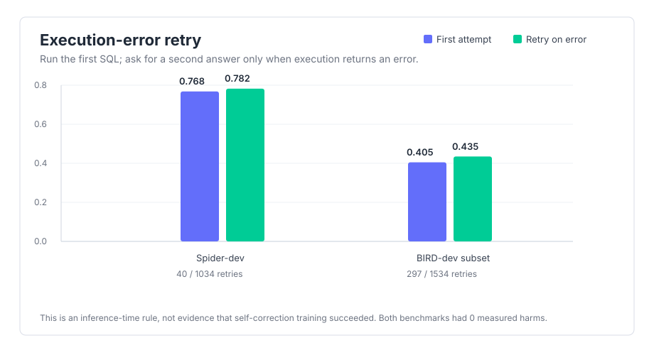

# llm-rlvr-sql

An LLM post-training project for learning purposes, with a simple test: can a 3B coding model get better when SQL execution is the reward?

The shipped result is **yes for single-turn RLVR**. Starting from **Qwen2.5-Coder-3B**, supervised fine-tuning (**SFT**) teaches the model the required answer format. The model is then trained with **GRPO** using execution-verified rewards, where generated SQL is rewarded based on whether it executes correctly.

This improves performance on both **Spider-dev** and **BIRD-dev** beyond the supervised fine-tuned baseline. The result is supported by:

- Three independent RL seeds
- Reward ablation
- **Llama-3.2-3B** control model
- Committed evaluation artifacts

The follow-up result is more mixed.

Training a **3B self-correction model** did not succeed. However, a simple inference-time rule worked well: run the first generated SQL query, and only ask the model for a second answer if execution fails.

This conditional retry strategy recovered much of the gain from always forcing a revision, while requiring far fewer second-generation calls.


## Main Result

| Benchmark | Base | SFT | RLVR | Gain from SFT | Evidence |
| --- | ---: | ---: | ---: | ---: | --- |
| Spider-dev | 0.625 | 0.678 | **0.779** | **+10.2pt** | 3 RL seeds, 95% CI excludes zero |
| BIRD-dev | 0.313 | 0.344 | **0.406** | **+6.1pt** | 3 RL seeds, 95% CI excludes zero |

What makes the result worth trusting:

- **The numbers re-run from committed artifacts.** `make eval` re-scores the saved completion sets; the README tables are not hand-entered experiment notes.
- **The RL gain is not one lucky seed.** The main Qwen result reports the mean of three GRPO seeds, and the RL-vs-SFT confidence interval excludes zero on both benchmarks.
- **The reward ablation still helps.** A near-binary reward also beats SFT, though it is weaker on BIRD, so the result is not only reward-shaping ceremony.
- **The pattern transfers to another 3B model.** Llama-3.2-3B improves under the same SFT -> GRPO recipe in the cross-family control.

See [`ARTIFACTS.md`](ARTIFACTS.md) for exact files, dataset pins, score reports, confidence intervals, and caveats.

## What Was Trained

The main run is intentionally narrow:

1. Generate one SQL answer for each question.
2. Execute it in a read-only SQLite sandbox.
3. Reward execution correctness, with guards against empty-result hacks.
4. Train LoRA adapters with GRPO.
5. Re-score Spider-dev and BIRD-dev from saved completions.

The model is not allowed to see hidden labels or write to databases. Datasets are pinned and fetched, not committed.

## Follow-Up: Execution-Error Retry

Beyond single-turn RLVR, the repo covers whether the same 3B model can check and fix its own SQL.



| Follow-up | Result | What to take from it |
| --- | --- | --- |
| Tool-calling loop | **Did not work.** Across 672 sampled episodes, base/SFT/RL/tool-use checkpoints made 0 `run_sql` calls. | At this size, the model did not learn the tool-use protocol. |
| Forced-revision training | **Stopped at the pilot gate.** The model drifted toward resubmitting the first answer instead of revising. | The pre-registered stop rule did its job; no full training claim is made. |
| Execution-error retry | **Worked as a cheap rule.** Ask for a second answer only when first execution errors. Spider: 0.768 -> 0.782 with 40/1034 second generations. BIRD: 0.405 -> 0.435 over locally decomposable items with 297/1534 second generations. Both had 0 harms. | Useful inference-time behavior, not evidence that self-correction training succeeded. |

That distinction is the point of the repo: the shipped research result is single-turn RLVR; the self-correction work is recorded as a boundary and a future direction.

## Reproduce The Tables

For a quick local smoke test, run the tiny demo:

```bash
make demo
```

Expected output:

```text
execution_accuracy=0.5000 well_formed_rate=0.0000 (1/2; gold_errors=0)
reasons={'match': 1, 'denotation_mismatch': 1}
```

The demo creates a temporary SQLite database, scores two fixed SQL completions, and exits. It does
not download data, load a model, use a GPU, or call Modal.

For the public verification path, re-score the committed artifacts:

```bash
make data
make eval
```

`make eval` is CPU-only and model-free: it loads committed completion sets, runs the verifier, and
prints the progression tables plus the retry follow-up numbers.
It may take a few minutes because it executes the saved SQL against Spider and BIRD databases.

`make eval` starts with a flat table like this:

```text
benchmark    setting                     EX  well-formed  correct/n
Spider-dev   cot zero-shot           ...
BIRD-dev     cot zero-shot           ...
```

It then prints the Spider/BIRD base -> SFT -> RL progression tables, the Llama control, and the
forced-revision pilot/error-only replay section. Warnings like `result has 19 columns (> cap 6)`
come from wide result rows where the verifier uses fixed column order instead of trying every
permutation.

Core local checks:

```bash
make install          # CPU environment: data, verifier, eval
make check            # lint, format check, unit tests
make test-integration # network/HuggingFace/model tests
```

GPU generation and training run through Modal entrypoints. Read [`RUNBOOK.md`](RUNBOOK.md) before launching paid jobs.

## Repository Layout

```text
src/llm_rlvr_sql/
  data/         Spider/BIRD loaders, typed examples, schema serialization
  env/          read-only SQLite sandbox and run_sql environment
  eval/         generation, scoring, provenance, revision/tool-use runners
  rewards/      single-turn rewards and multi-turn trajectory scoring
  train/        trace sampling, LoRA SFT, GRPO, forced-revision rollout, diagnostics
  report/       progression tables and caveats
  third_party/  vendored Test-Suite SQL Eval execution verifier
```

## Related Repo

This is the build-and-train companion to [`grpo-gain-decomposition`](https://github.com/adamthuvesen/grpo-gain-decomposition), which asks how much of RL reasoning gains are real versus measurement artifacts.

## Data And License

Spider is CC-BY-SA-4.0. BIRD-dev is CC-BY-NC-4.0. The vendored evaluator is Apache 2.0. Datasets and databases are pinned and fetched, not committed.

This repository's own code is MIT licensed.
