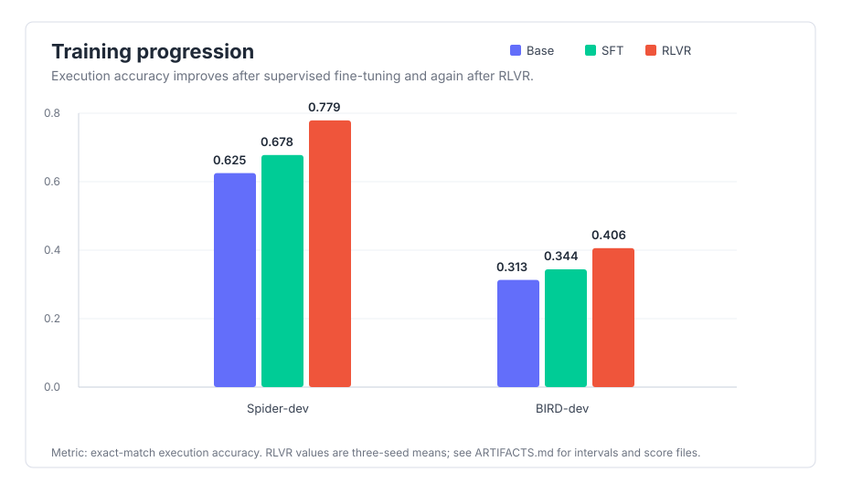

# llm-rlvr-sql

Execution-verified post-training for text-to-SQL.

The question is narrow: can a 3B coding model improve when the reward is the result of
running its SQL? In this repo, yes. Starting from Qwen2.5-Coder-3B, a LoRA SFT cold start
teaches the answer format, then GRPO trains against a reward computed by executing the
model's SQL in a read-only SQLite sandbox.

The main result is single-turn: one question, one generated SQL query, one execution-verified
reward. It improves over the SFT baseline on both Spider-dev and BIRD-dev.



| Benchmark  |  Base |   SFT |      GRPO | Gain vs SFT | Evidence                      |
| ---------- | ----: | ----: | --------: | ----------: | ----------------------------- |
| Spider-dev | 0.625 | 0.678 | **0.779** | **+10.2pt** | 3 seeds, 95% CI excludes zero |
| BIRD-dev   | 0.313 | 0.344 | **0.406** |  **+6.1pt** | 3 seeds, 95% CI excludes zero |

## Why Trust It

- The reported numbers re-run from committed `CompletionSet` artifacts with `make eval`.
- The main Qwen result uses three independent GRPO seeds, aggregated at the seed level.
- A near-binary reward ablation also beats SFT, though it is weaker on BIRD.
- The same SFT -> GRPO recipe improves a Llama-3.2-3B control model.
- The verifier used for evaluation is the same execution-match path used by the training reward.

Exact artifact paths, dataset pins, score reports, confidence intervals, and caveats are in
[`docs/ARTIFACTS.md`](docs/ARTIFACTS.md).

## What Is In The Repo

The main training path is deliberately small:

1. Build prompts from pinned Spider/BIRD records.
2. Generate one SQL answer per question.
3. Execute predicted and gold SQL in a read-only SQLite sandbox.
4. Score denotation match, with a guard against always-empty-result reward hacking during training.
5. Train LoRA adapters with SFT, then GRPO.
6. Re-score saved completions without loading a model.

The model never sees hidden labels during reward computation and cannot write to the databases.
Datasets are pinned and fetched; database files are not committed.

## Self-Correction Results

The repo also records a negative result: training this 3B model to use execution feedback for
self-correction did not work.


| Attempt                            | Result                                                                                                                                                                                                                                                               |
| ---------------------------------- | -------------------------------------------------------------------------------------------------------------------------------------------------------------------------------------------------------------------------------------------------------------------- |
| Tool-calling loop                  | Across 672 sampled episodes, base/SFT/GRPO/tool-use checkpoints made 0 `run_sql` calls.                                                                                                                                                                              |
| Forced-revision training           | Retained as analysis tooling; it did not produce the shipped training result.                                                                                                                                                                                        |
| Error-only retry at inference time | Useful as a rule: ask for a second answer only when the first SQL execution errors. Spider improved 0.768 -> 0.782 with 40/1034 second generations; BIRD improved 0.405 -> 0.435 over locally decomposable items with 297/1534 second generations. Both had 0 harms. |

That last row is an inference-time policy, not evidence that self-correction training succeeded.
The shipped training result is the single-turn GRPO result above.

## Reproduce

Fast local checks:

```bash
make install
make check
```

`make check` is the normal development gate: ruff, format-check, and unit tests. It does not
download datasets, launch models, or run Modal jobs.

Tiny no-GPU demo:

```bash
make demo
```

Expected output:

```text
execution_accuracy=0.5000 well_formed_rate=0.0000 (1/2; gold_errors=0)
reasons={'match': 1, 'denotation_mismatch': 1}
```

Full artifact re-score:

```bash
make data
make eval
```

`make eval` is CPU-only and model-free, but it is not a quick test. It executes the committed
SQL completions against Spider and BIRD databases and prints the result tables. Run it when
artifacts, scoring, or reported numbers change.

GPU generation and training run through Modal entrypoints in `modal_app.py`. Read
[`docs/RUNBOOK.md`](docs/RUNBOOK.md) before launching paid jobs.

## Caveats

- Accuracy is single-DB execution match, not test-suite multi-DB accuracy. The README and
  reports disclose the known single-DB false-positive caveat.
- All main evals are greedy. The max-token difference between base/SFT and RL evals is quantified
  in [`docs/ARTIFACTS.md`](docs/ARTIFACTS.md).
- The self-correction support code remains tested, but it is not the main claim.

## Repository Layout

```text
src/llm_rlvr_sql/
  data/         Spider/BIRD loaders, typed records, schema serialization
  env/          read-only SQLite sandbox and run_sql environment
  eval/         generation, scoring, provenance, artifact replay
  rewards/      execution rewards and trajectory scoring
  train/        trace sampling, LoRA SFT, GRPO, diagnostics
  revision/     forced-revision rollout, smoke tests, feedback artifacts
  report/       progression tables and caveats
  third_party/  vendored Test-Suite SQL Eval execution verifier
```

## Related Repo

This is the build-and-train companion to
[`grpo-gain-decomposition`](https://github.com/adamthuvesen/grpo-gain-decomposition), which
studies how much of measured RL reasoning gains come from real improvement versus evaluation
artifacts.

## Data And License

Spider is CC-BY-SA-4.0. BIRD-dev is CC-BY-NC-4.0. The vendored evaluator is Apache 2.0.
Datasets and databases are pinned and fetched, not committed.

This repository's own code is MIT licensed.
